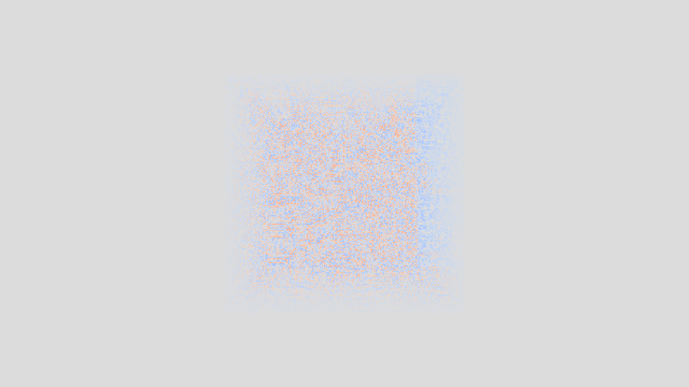
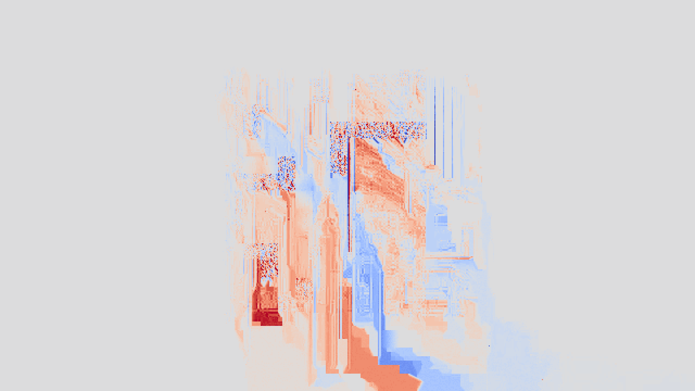
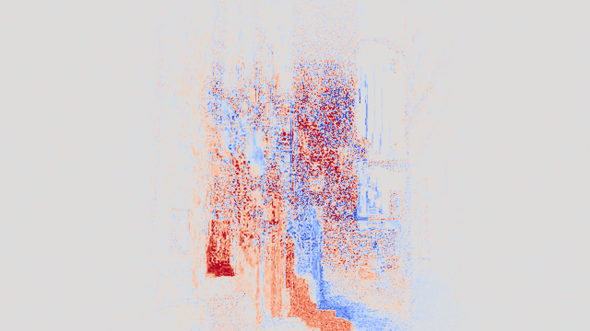
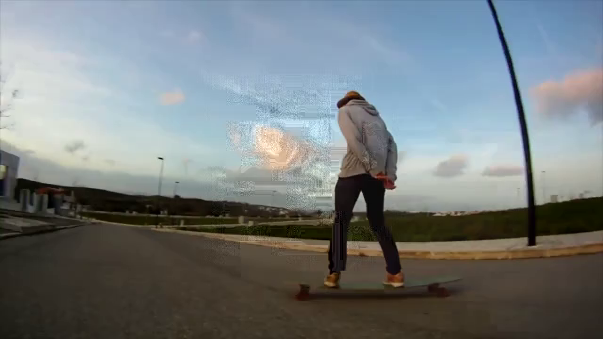
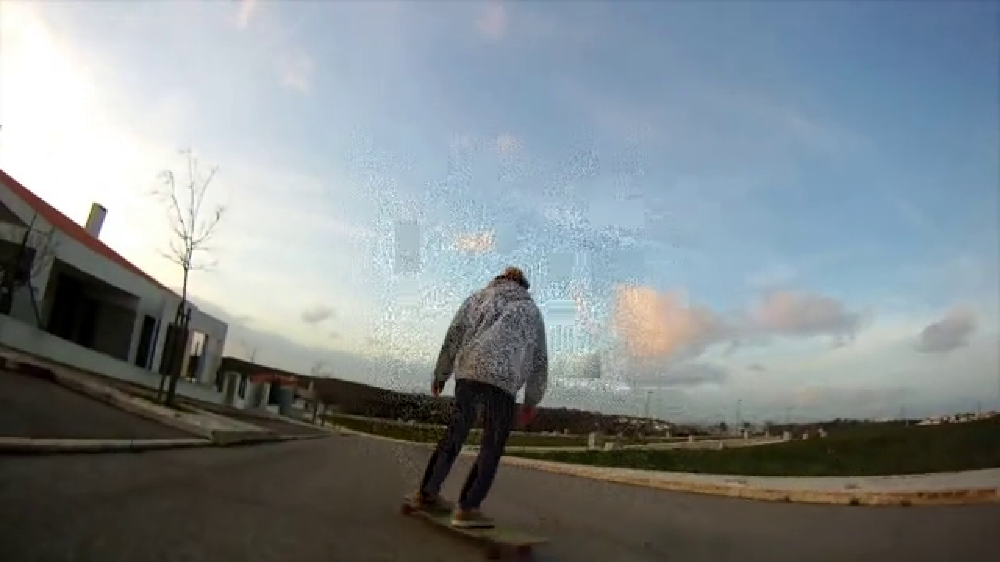
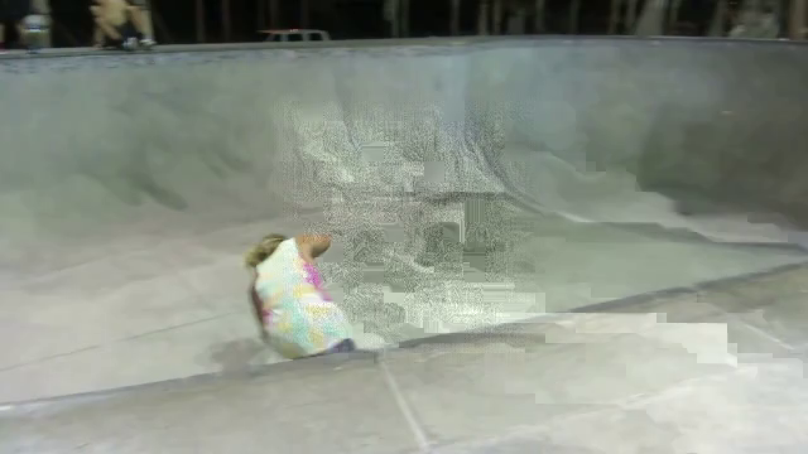
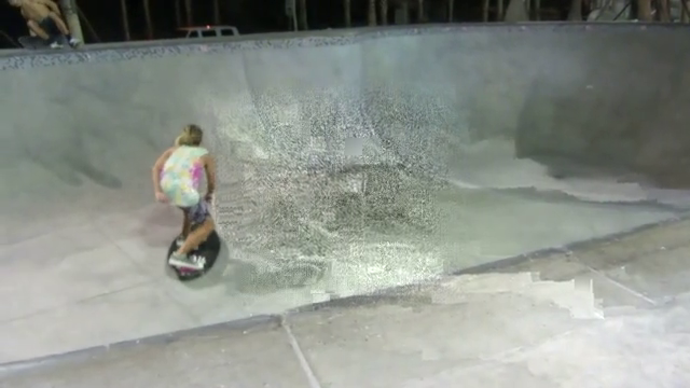

# Injecting Adversarial Perturbations into H.264 Video Compression

**Verena Lachner**\* (University of Innsbruck) · **Chiara Musso**\* (University of Trento) · **Giulia Boato** (University of Trento) · **Rainer Böhme** (University of Innsbruck)

\* Equal contribution

---
Video compression tends to wipe out adversarial perturbations, so evasion attacks against video classifiers rarely survive in practice. We inject the perturbations **directly into the quantized transform coefficients of an H.264 bitstream**, producing a valid H.264 stream that still fools synthetic-video detectors. Across all evaluated configurations, our method improves the Attack Success Rate (ASR) over direct H.264 compression by **+20.1 %-pts on average** and **up to +32.5 %-pts**.

## Abstract

We present a method that injects adversarial perturbations directly into the quantized transform domain of H.264-compressed video streams, overcoming the phenomenon that video compression tends to wipe out evasion attacks. We demonstrate the principle and its effectiveness by showing how it can be used to fool a synthetic video detector. We also quantify the gain in ASR for two detector architectures, two attack variants, and two H.264 quality settings. Our results imply that evasion attacks are a practical threat in everyday environments where video is handled in a compressed form.

## Method overview

1. **Compression-aware attack.** A white-box attack (FGSM or PGD, ℓ∞ budget ε = 8/255) is run frame by frame on the uncompressed video. Each frame's perturbation is initialized with the previous frame's final perturbation, and the adversarial loss treats the current perturbation as the best estimate for all future frames — anticipating H.264 inter-prediction.
2. **Bitstream parsing.** A custom H.264 parser/decoder (written in Julia) decodes the CABAC entropy coding and stores, per macroblock, its type, partitioning, QP and quantized levels.
3. **Custom transformation.** The baseline perturbation `p_B` is converted RGB → YCbCr, chroma-subsampled (4:2:0), transformed with the H.264 integer DCT matching the block's partitioning, and quantized with the block's QP. Rounding is **biased away from zero** to amplify the attack direction, but only for quantization-table entries below a threshold (the table's median) to avoid severe artifacts.
4. **Re-encoding.** The transformed perturbation `p_T` is added to the original levels and CABAC is re-run, keeping all of the encoder's rate–distortion decisions. The output is a standard-compliant H.264 bitstream.

## Proof of concept

### Real video, attacked against 3D-ViT (PGD, QP 23)

Frames 1 (I-frame) and 16 (P-frame) of the attacked H.264 video:

| Frame 1 (I) | Frame 16 (P) |
|:---:|:---:|
|  |  |

Baseline perturbations `p_B` produced by the attack (concentrated in the region evaluated by 3D-ViT):

| `p_B,1` | `p_B,16` |
|:---:|:---:|
|  |  |

Effective perturbations `p_E` after injection and decoding (same color scale). They are stronger than `p_B`, show block structure, and "bleed" towards the bottom-right due to intra-prediction; inter-prediction makes this more pronounced over time:

| `p_E,1` | `p_E,16` |
|:---:|:---:|
|  |  |

### More successfully attacked H.264 videos (QP 23)

A rather static scene and a scene with a camera pan:

| Frame 1 (I) | Frame 16 (P) |
|:---:|:---:|
|  |  |
|  |  |

### Failure case: visible artifacts

In homogeneous areas, prediction during decoding can amplify the injected perturbations into clearly visible artifacts, even in the first I-frame:

| Frame 1 (I) | Frame 16 (P) |
|:---:|:---:|
|  |  |

## Results

120 videos from the VideoDiffusion dataset (20 per source: 1 real + 5 generators), all with 100 % ASR before compression. Encoder: x264 via FFmpeg 6.1.1, 1 I-frame + 15 P-frames, 4:2:0.

| Detector | Attack | QP | Direct H.264 ASR | **Our method** ASR | Gain (%-pts) |
|---|---|:---:|:---:|:---:|:---:|
| 3D-ViT | PGD  | 23 | 57.5 % | **85.8 %** | +28.3 |
| 3D-ViT | FGSM | 23 | 40.0 % | **72.5 %** | +32.5 |
| R3D    | PGD  | 23 | 80.0 % | **95.8 %** | +15.8 |
| R3D    | FGSM | 23 | 67.5 % | **90.0 %** | +22.5 |
| 3D-ViT | PGD  | 18 | 73.3 % | **92.5 %** | +19.2 |
| 3D-ViT | FGSM | 18 | 60.0 % | **82.5 %** | +22.5 |
| R3D    | PGD  | 18 | 91.7 % | **99.2 %** | +7.5  |
| R3D    | FGSM | 18 | 84.2 % | **96.7 %** | +12.5 |

## Limitations

- Prediction during decoding can produce visible artifacts, especially in videos with homogeneous textures.
- Injection increases the bitstream size by about 19 % on average, so the method may be detectable at stream level when the encoder and its settings are known.

## Code availability

To reduce the risk of misuse, **the source code of the injection method is not released**. This repository contains the paper and supplementary figures only.

## Citation

```bibtex
@inproceedings{lachner2026injecting,
  title     = {Injecting Adversarial Perturbations into {H.264} Video Compression},
  author    = {Lachner, Verena and Musso, Chiara and Boato, Giulia and B{\"o}hme, Rainer},
  booktitle = {IEEE International Workshop on Information Forensics and Security (WIFS)},
  year      = {2026}
}
```
